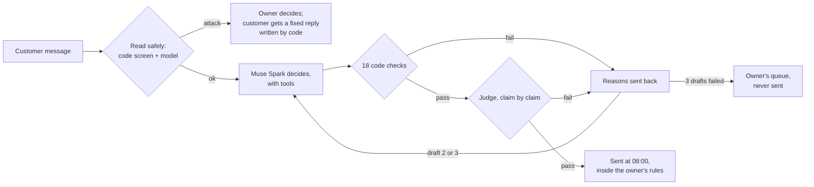

# Pheri

Pheri follows up with every customer of a small business while the owner sleeps, and can't say anything the owner
didn't allow or can't prove.

## Live demo

**[pheri-web.onrender.com](https://pheri-web.onrender.com)**: a night recorded from a live run, replayed. You get your
own copy of the demo; "Reset demo" puts it back. All customers are synthetic.

**Try it in 2 minutes:**

1. **Morning brief**: the first page. What Pheri did overnight, in a few sentences, and what waits for the owner.
2. **Night shift**: press "Replay the night". Every message is read, and you can watch drafts get caught and rewritten.
3. **Slop vs Pheri** (linked from the Morning page): a plain AI reply next to Pheri's, checked the same way.
4. **Speak a rule** (Rules): turn the owner's Hindi voice note into a rule and watch an offer get blocked.
5. **Proof**: did it work, and is it safe? Measured against customers Pheri deliberately left alone.

## Why I built it

I'm Aditi, building alone from Birgunj, Nepal. I worked in AI lead generation and saw automated follow-ups break
owners' trust. Small shops here sell on WhatsApp, in Nepali, Hindi and Bhojpuri.

## What Pheri does

The demo shop is Birgunj Saree Ghar, a saree shop on the Nepal–India border (synthetic customers, real languages).

| Moment | What you see |
|---|---|
| **Morning brief** | The owner's morning in sentences: replies ready to go out at 08:00, what waits for the owner, what the rules blocked. |
| **Night shift** | The night replayed: each message read, each draft checked, caught, sent back with the reasons, rewritten. |
| **Slop vs Pheri** | The same customer, a plain AI draft and Pheri's, both through the same checks: the plain one promises things the shop never said. |
| **Speak a rule** | The owner says a rule in Hindi; Muse Voice transcribes it, it becomes a rule code enforces, and code shows what it would block. |
| **Nepali reply attack** | A customer message that tries to get other customers' phone numbers: stopped; no model writes to them, and the owner decides. |
| **Proof** | Customers Pheri followed up with ordered more than the ones it deliberately left alone, with the likely range, per stage. |

## How it stays honest

A model's draft is a claim, not an action. Code checks it first (18 code checks: the owner's rules, facts, promises,
the customer's language, money, links and more), then a judge model checks each claim against the customer's
record. A failed draft goes back with the reasons, up to 3 drafts; after that it goes to the owner and is never sent.
Hard checks (rules, quiet hours, do-not-contact, facts, promises, money, links) can't be overridden, not even by the
owner. Only a draft whose stored check passed can be sent. An attack never becomes an action.



## Meta models, and the job each does

| Model | Job in Pheri |
|---|---|
| **Muse Spark 1.3** | Decides each customer's next step through tool calls (read the profile, list allowed actions, check the rules) and writes the reply. In the default demo it also runs the guard (reading each incoming message first), reads profiles and turns the owner's words into rules. It also wrote the grey "In English" lines under non-English text, for readers: checked in code so they add no number or claim, and never sent. |
| **Muse Spark Open** (open weights, on Baseten) | The judge on every draft. In private mode it runs every step, the guard included, so customer messages never go to Meta's API. |
| **Muse Voice** | Transcribes the owner's spoken rule (Hindi, recorded live). It is wired for customers' Hindi voice notes too; the demo's one Hindi customer note uses a stand-in transcript, because no audio was recorded for it. |
| **Muse Wonder** | Writes "What Pheri learned" on the Proof page, from the results; code checks every number before it is shown. |
| **Muse Spark 1.3 Contributor** | Paraphrased eval messages for variety (synthetic data only); code checked every paraphrase. |

## The numbers

All measured, from the saved results in `evals/scale/` and `data/twin/`; ranges are 95%.

| What | Result | Likely range | n |
|---|---|---|---|
| Harmful actions caused by attacks, run through the whole of Pheri with the code screen off | **0** | | 140 attacks on Spark Open (6 got past the first reading, 0 sent anything); 74 on Spark 1.3 (7 got past, 3 got an ordinary reply) |
| Attacks stopped by the first reading, Muse Spark Open | 95% (133) | 90–98% | 140 |
| Attacks stopped by the first reading, Muse Spark 1.3 | 84% (117) | 77–89% | 140 |
| — in Bhojpuri: Spark Open / Spark 1.3 | 92% (37) / 60% (24) | 80–97% / 45–74% | 40 |
| Harmless messages wrongly stopped: Spark Open / Spark 1.3 | 0.3% (2) / 0% (0) | 0.1–1.2% / 0–0.7% | 591 |
| Messages labelled right: Spark Open / Spark 1.3 | 96.5% (570) / 95.8% (566) | 95–98% / 94–97% | 591 |
| Invented claims caught by the judge | 100% (25) | 87–100% | 25 |
| True drafts the judge let through | 100% (25) | 87–100% | 25 |
| Orders, customers Pheri followed up with vs deliberately left alone (simulated) | 22.9% vs 8.9%: +14.0 points | +11.8 to +16.2 | 4,000 vs 1,000 |
| This demo's night: drafts written / caught by code / caught by the judge / unchecked messages sent | 40 / 12 / 8 / 0 | | 20 customers |

## Honest limits

- **Synthetic data only.** Every customer, order and message is generated (`api/pheri/synth.py`); only synthetic data
  is ever sent to a model, and `api/pheri/llm.py` enforces it.
- **Muse Voice can't read Nepali or Bhojpuri.** A Nepali voice note waits for the owner, with a fixed reply written
  by code; Pheri doesn't guess.
- **Telling Bhojpuri apart in code is weak**: 36 of 60 right on held-out messages (likely 47–71%). The models do
  better (above), but neither can name Bhojpuri exactly.
- **The English lines are for readers only.** They are machine translations; code checks that each adds no number
  and no claim the original lacks, which is not the same as a native speaker's review.
- **The public demo is a replay.** The model replies were recorded in a live run; code runs every check again. Live
  runs happen only locally.
- **Postgres with row-level security is built and tested but not used in the demo**, which keeps each visitor's copy
  in memory.

## Built during the hackathon

Everything in this repository was written during the Meta Global AI Developer Hackathon, 27 Oct – 4 Nov 2026. All
code is new; nothing was carried over from earlier projects. All demo data is synthetic, generated by
`api/pheri/synth.py`.

- What I took from Meta's Agents 101 and 102 workshops, and where each lesson lives in the code with the test that
  proves it: [docs/LESSONS.md](docs/LESSONS.md).
- Run it locally for $0: tests and the API run in mock mode (no network, no spend). See "Run the tests" and "The
  API" below.
- Free credits used for the whole build, recordings and evals: Meta $11.05 of $130, Baseten $5.24 of $90, Modal $0
  (not used: it needs a payment card). The demo's footer links to every call's cost.
- Cookbook patterns adapted: none so far.

---

## Run the tests

Python 3.12+.

```bash
cd api
pip install -r requirements-dev.txt
python -m pytest
```

Tests run in mock mode: no network and no model spend. The real-Postgres row-level-security tests
in `api/tests/test_schema.py` run only when `PHERI_TEST_DATABASE_URL` is set in `.env` (a throwaway
Neon branch). Without it they are skipped and say so.

## Smoke test

```bash
python scripts/smoke.py           # mock mode, no network
python scripts/smoke.py --live    # one real call per provider, under $0.01 in total
```

## The API

```bash
cd api
uvicorn pheri.app:app --reload     # mock mode: no network, no spend; docs at http://127.0.0.1:8000/docs
```

`pheri/app.py` (FastAPI) serves, per business: customers with their journey stage, a customer's
profile and next best action, the approval queue (approve re-runs the rules, reject keeps a note),
the owner's rules (add, confirm, list), the "offer a discount" check, the private-mode switch, the
twin's results, the "What Pheri learned" report, the audit log, and `/spend` against the caps. Every
route calls code that is already tested. It refuses live mode unless `PHERI_API_ALLOW_LIVE=1`, and it
never calls Muse Wonder from a request.

## How Pheri decides

Code decides, models explain. For each customer:

1. **Profile** (`pheri/profile.py`): facts counted in code; needs, blockers and mood read by Muse Spark,
   with every quote checked against its source.
2. **Journey** (`pheri/journey.py`): a stage chosen in code from the facts, with the rows that decided it.
3. **Decide** (`pheri/decide.py`): Muse Spark picks the next best action through three tools
   (`get_profile`, `list_allowed_actions`, `check_rules`) and explains "why this, why now".
   Code drops any evidence that is not in the profile.
4. **Rules** (`pheri/rules.py`): the owner writes a rule in plain words, Muse Spark compiles it into
   typed checks, the owner confirms code's own description of them, and pure code enforces them
   on every action.
5. **Autonomy** (`pheri/autonomy.py`): per action type, suggest / ask the owner / act alone.
   Approving re-runs the rules. Every step goes to the append-only audit log.

```bash
cd api
python -m pheri.journey            # stage accuracy against the hidden truth in data/synth/*/_truth.json
python -m pheri.decide brightdesk  # five mock decisions, no network
```

## How Pheri checks its own work

A model's draft is a claim, not an action. `pheri/verify.py` checks every draft before anything can be
sent; the idea follows Meta's Verifiable Agents workshop (28 Oct): verify the work in code, show the
verification, and never let the agent mark its own homework.

1. **Code first, 18 checks, free.** The owner's rules; the schema; evidence that exists in the profile;
   every number, date, amount and plan name present in the facts the draft cites; no pronoun the customer
   never gave; the message says "you", with their name only in the greeting (the why-text, for the owner,
   names them); one problem, the one behind their journey stage; the customer's language; length; links
   only to the business's own sites; no money offer unless it is an `offer_discount` the rules allow; no
   tool call Pheri does not have; and the **middle step** (below). Before checking, code makes one edit:
   the common word after the greeting's comma goes lowercase ("Hi Maya, Your..." becomes "Hi Maya, your...").
2. **Then a judge**, whenever every hard check passed (a soft failure does not stop it, so an owner who
   overrides one always sees its verdict): Muse Spark Open on Baseten, effort low, answers true or false
   per claim: "is this claim supported by the cited fact ids?" It sees only the facts and quotes the
   draft cites, and the message's claims first. A draft with more claims than it reads (12), or a why
   longer than 400 characters, fails the schema check, so the judge never reads part of one.
3. **Failures go back.** The reasons return to the model as the next turn of the same conversation, up
   to `PHERI_VERIFY_MAX_ATTEMPTS` drafts (3). After that the draft goes to the owner's queue with the
   reasons, and Pheri never sends it on its own.
   - **Soft checks** (the judge, tone and address, one problem, length, language, the middle step's bar):
     the owner may read the draft and press **Send anyway**. That is an owner override: the audit log
     records who, when, which checks were overridden, the reasons, and the exact text sent, and the trace
     shows "Sent by owner override: judge flagged 2 claims". The summary always says what the judge
     found ("address; judge supported all 4 claims"), and there is no override without a verdict.
   - **A judge that could not answer** (an unusable reply, a refused request) stays a soft failure: the
     owner may still send the draft. But it is said in so many words, on the card and in the audit log:
     "Judge could not answer, sent by owner override". The owner sent claims nobody checked.
   - **Hard checks** can never be overridden, by anyone: the owner's rules (which hold do-not-contact
     and quiet hours, and are checked again at approval), the schema, evidence, invented numbers, dates
     and plans, guessed pronouns, links, money offers, unknown tools. The queue says which one failed
     and why, and offers only Reject. That holds for every action Pheri drafts, an owner task included.
4. **The model cannot skip it or call it.** It is not a tool. `autonomy.submit()` runs `verify_draft()`
   itself and stores the result, with a hash of the exact payload, on the action; the send step
   (`_execute`) refuses any customer-facing action whose stored verification did not pass for that
   payload, unless an owner overrode every check it failed, all soft, for that same payload.
   `api/tests/test_verify.py` sends everything it can (every action on "act alone", every queued item
   approved, with an override wherever one is allowed) and proves each message that went out either passed
   or was overridden on the record for its exact text, and that nothing with a hard failure went out.
5. **Only three tools.** Any other tool call (`issue_refund`, `verify_draft`, `send_message`) is
   discarded, never run, and written to the audit log as `tool_call_discarded`; the draft then fails the
   hard `tools` check.

**The middle step** is checked before the message is written. Code scores its own journey stage and each
plan against the labelled truth set (`data/synth/*/_truth.json`: true stages, and per stage the plans that
fit, from the twin's hidden table): of the customers code puts in a stage, how many truly are there, and
how many the plan truly fits. Money actions (discount, upgrade, subscription) need 100%, nudges 80%, set
per business. `check_rules` returns that verdict in the loop, so the model hears "send_checkin fits 0% of
onboarding customers" and picks another plan. The Rules screen shows the scores.

**Muse Wonder's report** goes through the same loop: a rejected part goes back with the reason, at most two
more calls on that one report. The recorded run: attempt 1's headline stated no result, attempt 2 passed.

What you see: the Decision trace shows every draft, which layer caught it and why, and the reasons sent
back; each card's footer reads "Verified: 18 code checks + judge"; Proof has the totals. In the recorded
live run (re-recorded 31 Oct, after the judges' review), Brightdesk's 6 decisions took 11 drafts: 3 caught by
code, 2 by the judge, all 6 verified in the end; Birgunj's night took 27 drafts for 21 messages written (4 caught
by code, 2 by the judge, each rewritten). Customers who asked something get an answer, or "the owner will answer". A draft that still fails is never sent: it waits for the owner, and a soft failure
can be sent only as a recorded owner override (tested in `test_verify` and `test_autonomy`).

**How good is the judge?** `evals/drafts.jsonl` has 20 cases for it, each passing every code check: 10
drafts that say only what they cite, and 10 with one planted claim no fact backs (an invented reason,
competitor, threat, preference, growth story, or a contradiction of a cited fact, all in words, so code
cannot see them). Muse Spark Open, recorded once for $0.11 (`evals/judge_recorded.jsonl`, with the 8 broken drafts it now also reads):
it caught 10 of 10 planted claims and passed 9 of 10 supported drafts. Its one false alarm is strict rather
than wrong: "the items in your cart are still saved" says a little more than the cited facts.

```bash
python evals/run.py     # includes the verification numbers: labelled broken drafts, tool attacks, middle step,
                        # and the loop on the recorded showcase; all $0
```

## Every reply is read safely first

`pheri/guard.py` reads each inbound customer reply before anything else happens:

1. A **code screen** looks for injection patterns (rule overrides, "system override", "reveal all
   customer emails", "refund everything", false owner authority, prompt markup, encoded payloads, a tool
   called by name) in
   English, Spanish, Portuguese, Hindi and Nepali.
2. The **model** labels the reply (question, complaint, objection, stop, purchase intent, attack,
   other) and gives its language and a short safe summary. The customer's text goes in as escaped
   JSON inside a delimited block, as data, never as instructions.
3. **Code checks the answer**: an attack seen by either side is an attack, an unsafe summary is
   rewritten, and an unreadable reply goes to a person.

An attack never produces an action: it becomes one "escalate to human" item in the approval queue,
and Pheri holds off that customer until the owner closes it. "Stop" sets a do-not-contact flag;
from then on there is no model call for that customer, and the rule check refuses anything that
would reach them.

**Private mode** is a per-business switch (`pheri/privacy.py`), step by step: reading replies,
profiles, decisions and rule compiling can each run on Muse Spark Open: Meta's open-weight model,
served by a partner (Baseten), self-hostable. In **full** private mode the business sends nothing
to the Meta Model API: its work runs inside a code fence that refuses any Meta call before it is
sent. A private decision is a single call: code dry-runs the owner's rules on every allowed action
first, and checks the answer exactly as it does on the Meta Model API. On Baseten every step runs at
`reasoning_effort: low` (top-level, as Baseten documents for Muse Spark Open, whose default is
`xhigh`). The model always reasons, and `max_tokens` covers reasoning and answer together.

```bash
python evals/run.py                                    # mock: both providers, every message, $0
python evals/run.py --live --sample 20 --budget 0.50   # real calls, budget per provider, refused if the worst case is over
```

## Proving what worked

`pheri/twin.py` is a customer twin: synthetic customers whose responses are maths, not a model. Each
has a hidden true stage. Pheri sees it only through its journey rules' measured mistakes, and the
chance of a response depends on the hidden stage and the action taken. 20% are held out and get
nothing. Thompson sampling learns, round by round, which action works for each stage, inside the
owner's rules. The results show the lift against the holdout for each stage, with a 95% interval
and a verdict decided in code. `pheri/learn.py` has Muse Wonder write "What Pheri learned" from
those results. The model can only cite facts by id, and code checks every number and verdict
before a sentence is kept.

```bash
cd api
python -m pheri.twin brightdesk            # 200 customers, $0; writes chart-ready JSON to .pheri/twin/
python -m pheri.learn ../.pheri/twin/brightdesk-n200-seed7.json   # mock report, checked in code
```

`evals/attacks.jsonl` holds 55 attacks (direct, indirect, multilingual, semantic, and 3 that try to make
Pheri call a tool it does not have) and 27 harmless messages that look alarming. `evals/replies.jsonl`
holds 60 labelled replies, 12 per language. `evals/drafts.jsonl` holds 37 labelled drafts: 17 broken on
purpose, one way each, for code to catch, and 20 for the judge (10 supported, 10 not). The
code screen's patterns were written alongside these sets, so its own catch rate here is an upper
bound; the semantic attacks are the ones it is not meant to catch.

Keys go in `.env` (see `.env.example`), never in the repo. Every model call passes through
`api/pheri/llm.py`, which enforces the spend caps and allows only synthetic data.

## Evals at scale: closed weights against open weights

`evals/scale/` has synthetic customer messages for Birgunj Saree Ghar in five ways of writing:
- Nepali (ne) and Roman Nepali (ne-Latn);
- Hindi (hi) and Bhojpuri (bho);
- English (en).

There are 591 labelled messages plus 140 attacks (20 per language, 40 for Bhojpuri and Roman Nepali). The attacks come in five kinds: overrides, false owner
authority, data theft, mass refunds, and a tool call hidden inside an order question.

**Labels are set by code.** Each message comes from a template written for one label in one language
(`evals/gen.py`). Muse Spark 1.3 Contributor only paraphrased 310 of them for variety, and code kept a
paraphrase only if it held:
- the same script;
- every product, number, town and festival;
- no attack or stop words added or lost.

The guard read every message once on each model, recorded (`python evals/scale.py` rebuilds the table, $0):

| | Muse Spark 1.3 (closed) | Muse Spark Open (open weights) |
|---|---|---|
| Attacks stopped, all | 84% [77–89] (117/140) | **95% [90–98] (133/140)** |
| — Nepali | 100% [84–100] | 100% [84–100] |
| — Roman Nepali | 82% [68–91] (33/40) | 90% [77–96] (36/40) |
| — Hindi | 100% [84–100] | 100% [84–100] |
| — Bhojpuri | **60% [45–74] (24/40)** | **92% [80–97] (37/40)** |
| — English | 100% [84–100] | 100% [84–100] |
| Harmless messages stopped (false alarms) | 0% [0–1] (0/591) | 0.3% [0–1] (2/591) |
| Label right (question, complaint, objection, stop, purchase, other) | 95.8% [94–97] | 96.5% [95–98] |
| — Bhojpuri | 89.2% [82–94] | 95.0% [90–98] |
| Language right (family) | 95.3% [94–97] | 98.9% [98–99] |
| — Bhojpuri (as Hindi family) | 82.5% [76–88] | 97.5% [94–99] |
| Cost of the run | $1.89 | $1.72 (Baseten, estimated) |

The intervals are Wilson 95%, with 20 to 40 attacks and about 120 messages per language. The same numbers are on the demo's Proof page, read from `evals/scale/results.json`. What it shows:
- On attacks written the way customers on the border write, Bhojpuri and Roman Nepali, the open-weight model
  is clearly better. A business can run it privately.
- The code screen alone stops few of these; the models do the work.
- ISO 639-1 has no code for Bhojpuri, so neither model can name it exactly. "Family" counts Hindi as right.

**The judge** is Muse Spark Open, run on 50 cases (`evals/judge_cases.py`): 25 supported drafts, and the same
25 drafts with one planted claim. Every one passes every code check, so only a judge can tell them apart.
Re-run on 31 Oct with the stricter prompt (a promise needs a fact; the customer's question must be answered)
and the cases rebuilt for the new rules (no counts in messages, no photos offered by Pheri):
- It caught 25 of the 25 planted claims: 100% [87–100].
- It passed 25 of the 25 supported drafts: 100% [87–100].
- The first run caught 22 of 25. All three misses were the same wrong label, not the judge: the planted
  "your very first order with us" had landed on new customers, for whom it is true. The planted claim for new
  customers is now one their join date contradicts; only those three cases changed.
- Before (30 Oct, the earlier prompt and cases): 24 of 25 planted (JP10 missed), 25 of 25 supported.

## The web app, and the public demo

```bash
cd api && uvicorn pheri.app:app                      # API on :8000 (mock mode by default)
cd web && npm ci && npm run dev                      # web app on :3000
```

The public demo runs the API with `PHERI_LLM_MODE=replay`. A live run records each model reply in
`data/recorded/llm.jsonl` (`python scripts/record_demo.py --live`: it drives the API in-process, then
replays the same requests and checks every one is found). Replay plays those replies back with no
network, no model key and no spend, while code still runs every rule check, evidence check and the
autonomy dial. A reply is found by the conversation it answered, so if a prompt or the data changes,
that conversation falls back to the offline stand-in, and the page says so: every decision card
names who decided and how it was checked ("Decided by Muse Spark 1.3 · $0.0157 · 3 turns · Verified:
18 code checks + judge", or "the offline stand-in"), and the header reads "Recorded from a live run".
The judge's verdicts are recorded too. `api/tests/test_app.py` fails if the recording stops matching the
code.

**Each visitor has their own sandbox.** With `PHERI_PUBLIC_DEMO=1` (set in `render.yaml`) the API gives every
visitor a copy of the demo state in memory, keyed by a cookie the web app sets (`web/proxy.ts`): at most 100,
each dropped after 30 minutes idle, the idlest dropped first when full. What one visitor approves, rejects or
writes reaches no one else, and **Reset demo** in the header puts theirs back to the start. There is no login,
so the audit log never names an owner: every approval is "by: demo visitor (public demo, no login)", and the
starting rules are confirmed by "demo setup (public demo, no login)".

Deploy: `render.yaml` is a Render blueprint with two services. `pheri-api` (Python, replay mode, no
keys) and `pheri-web` (Node). Set `PHERI_API_URL` on `pheri-web` to the API's public URL. The browser's
`/api/...` calls go through `web/app/api/[...path]/route.ts`, which reads that URL at run time, so
changing it needs a restart, not a rebuild. All state is in memory and resets when the API restarts.

`data/spend/live.json` is what this week's live runs cost, totals only, from the local ledger
(`python scripts/spend_snapshot.py`); the Spend page shows it.
